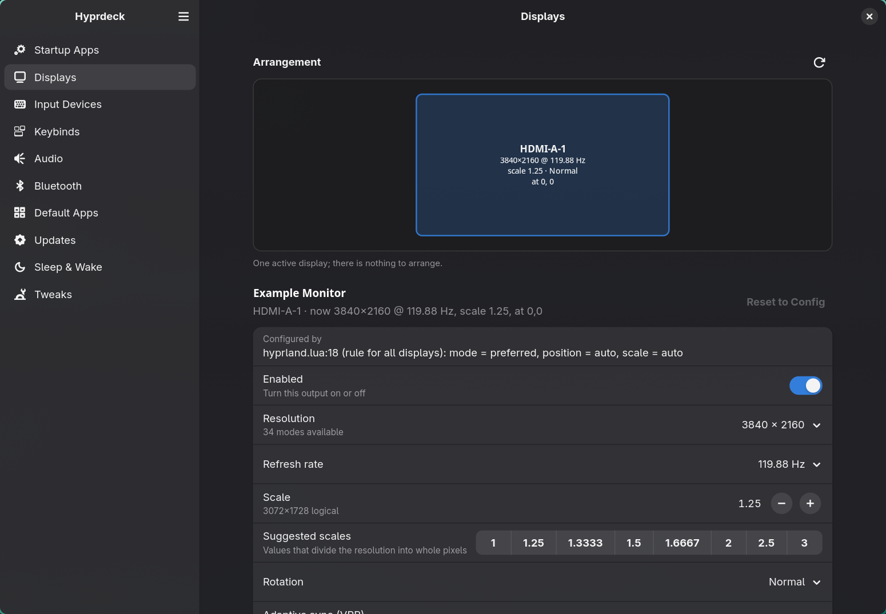
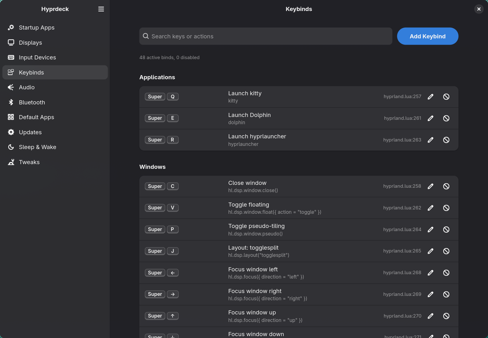
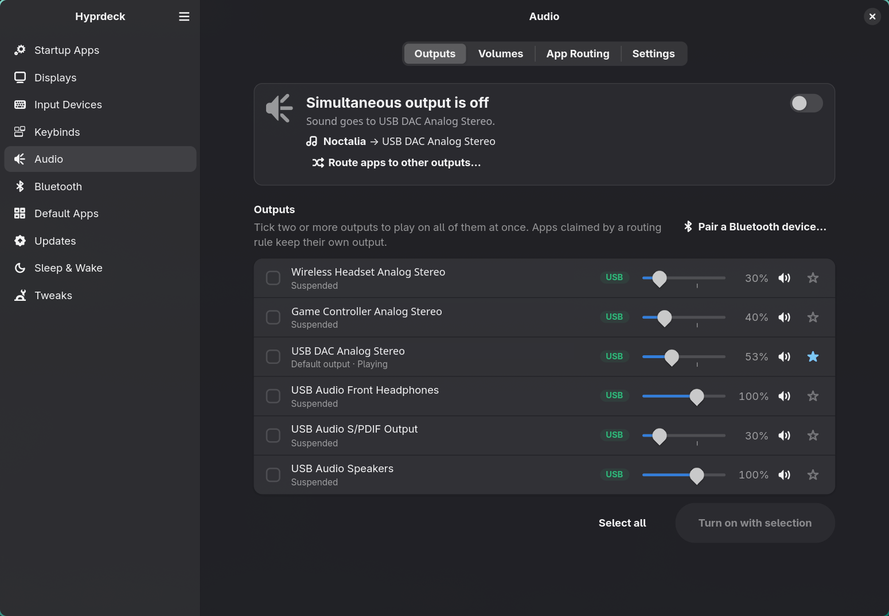
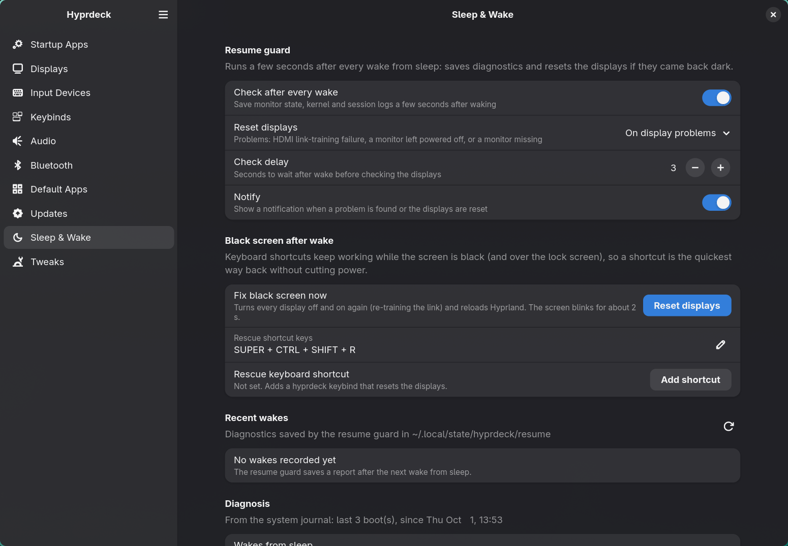
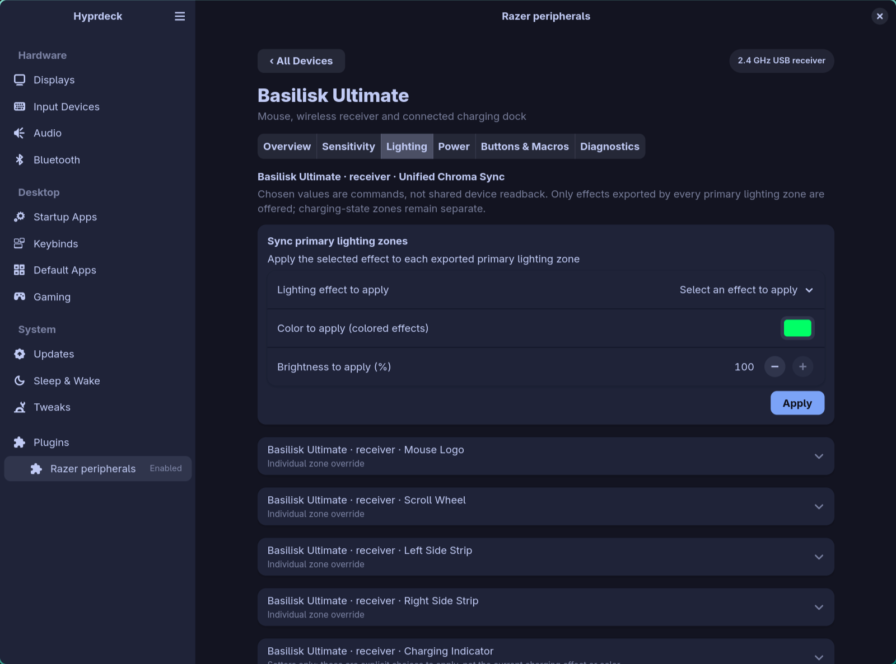
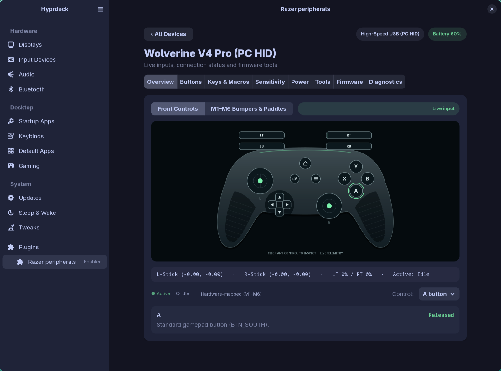
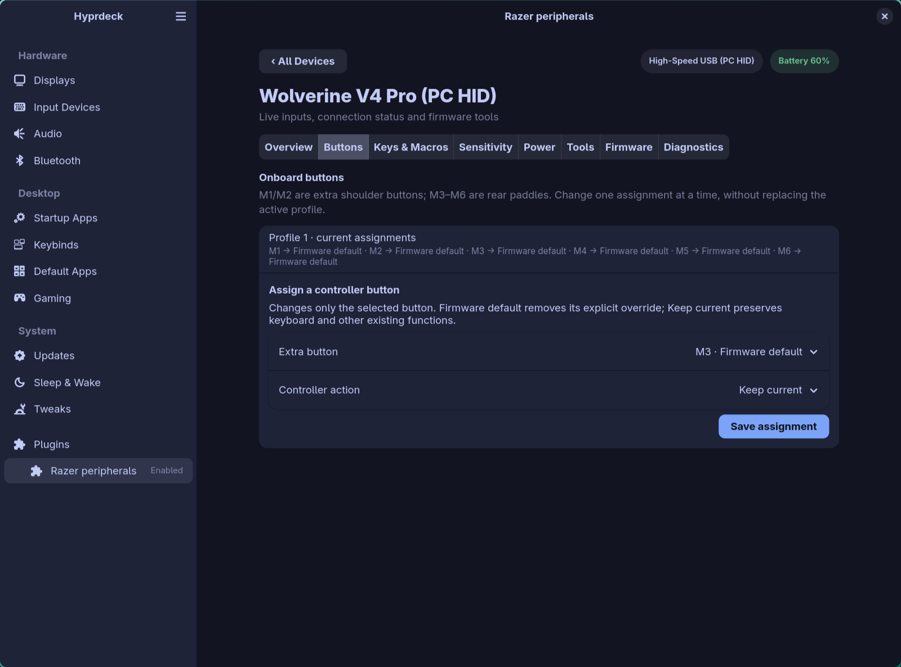
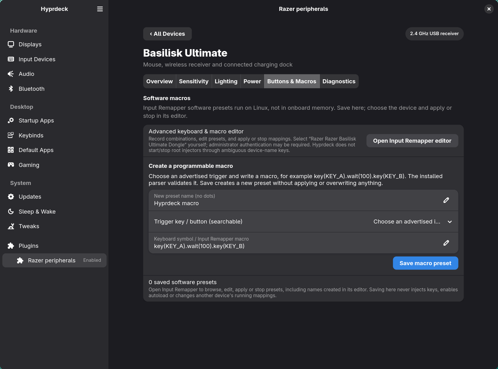
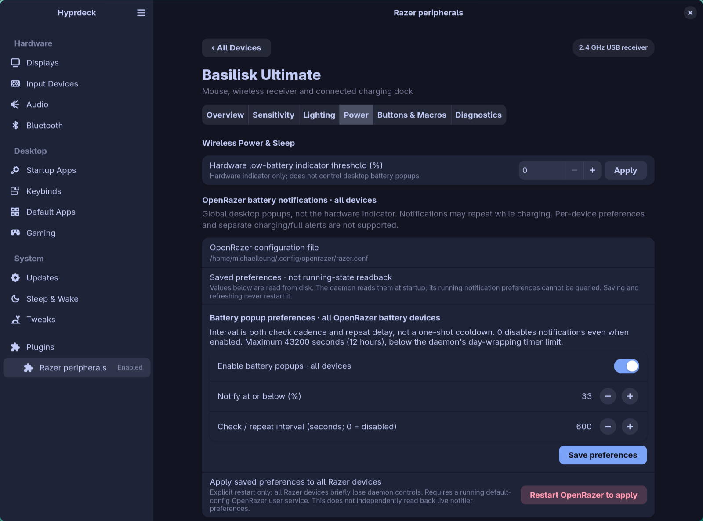

# Hyprdeck

A control center for [Hyprland](https://hypr.land) desktops. Manage startup apps, displays, input and
keybinds, audio, Bluetooth, default apps, package updates, and sleep/wake recovery in one GTK4/libadwaita
app. It lives in your tray from login.

Hyprdeck reads your **Lua** Hyprland config (Hyprland 0.56+). It evaluates it against a recording mock
of the `hl` API, so every bind, rule and option shows the file and line it comes from, even when built
from variables, loops and `require`s. Your own changes go to one generated file, `hyprdeck.lua`, which
loads last. Your hand-written config is never rewritten behind your back.

<p align="center">
  
  
  
  
</p>

## Features

| Page | What it does |
| --- | --- |
| **Startup Apps** | XDG autostart entries, systemd user services and `hl.on("hyprland.start")` commands in one list. Enable/disable for the next login, start/stop/restart now, view logs, add apps, and delete entries you own (with a preview of every file removed). |
| **Displays** | Drag-to-arrange layout. Resolution, refresh rate, scale (only values Hyprland accepts), rotation, VRR, mirroring, color management and HDR (SDR brightness/saturation/luminance, EOTF, bit depth, ICC). Changes apply behind a 15 s keep-or-revert countdown. Brightness, contrast and input source over DDC/CI via `ddcutil`. |
| **Gaming** | Launch Steam Big Picture inside native Wayland Gamescope with Steam Input/overlay integration. Detect the focused or selected output’s physical resolution, refresh rate, HDR preset and VRR policy; override rendering, presentation and frame-rate settings. Preview/copy the command, save a profile, and reopen an existing session without duplicates. Desktop Steam restarts only after confirmation. |
| **Input Devices** | Keyboard layouts, options and repeat; pointer, focus and touchpad behaviour; cursor; overrides per physical device. Every value shows where it comes from: config file:line, hyprdeck, or default. |
| **Keybinds** | Every effective bind in readable form, grouped and searchable. Add, edit, disable and restore binds. Record key combos (even ones Hyprland already grabs). Pick an app, a shell action, a window/workspace action or any dispatcher. Warns before replacing an existing bind. |
| **Audio** | Play through several outputs at once (a PipeWire combine sink) and route specific apps to specific outputs. Includes volumes, default output, a "what's playing where" overview, and a tray submenu. |
| **Bluetooth** | Scan, pair (PIN/passkey dialogs), trust, connect, rename, block and forget devices, with battery levels. Tray submenu. |
| **Default Apps** | Default browser, mail, files, editor, image/video/music players, documents, archives and terminal (`xdg-terminal-exec`). Detects and fixes "mixed" handlers. Can sync Hyprland launcher variables such as `$BROWSER`. Advanced per-MIME-type and URL-scheme editor. |
| **Updates** | Repo and AUR updates in-app: a review screen (unread Arch news, and for every AUR package a PKGBUILD diff plus a security scan you approve), then one password prompt and a progress bar with a live log. AUR packages are built as your user, never as root. Background checks with notifications. Compares detected components (Hyprland, Noctalia, Quickshell, Waybar, hyprlock, …) to their upstream releases, and can switch to or from `-git` packages. Updates Hyprdeck itself (see below). |
| **Sleep & Wake** | A resume guard saves diagnostics after every wake. If a display comes back dark (for example after an HDMI FRL link-training failure), it resets the display with a DPMS cycle and reload. Also: a "fix black screen" button and optional keybind, journal-based wake history, and GPU power-management checks. |
| **Tweaks** | Game mode (runtime only), config health (errors, overridden options and binds), Hyprland log viewer. Corsair/OpenLinkHub resume tuning when present. |
| **Plugins** | Separate trusted integrations with physical-product cards and dedicated device pages. Mouse, receiver and dock components stay together; sensitivity, lighting, buttons/macros and diagnostics have their own sections. Native controller diagrams, color pickers and structured forms use real backend capabilities. Independent checksum-verified plugin releases; no bundled vendor backend. |

Pages and sections adapt to what's installed: missing `ddcutil`, `bluetoothd`, `pacman`, an AUR helper,
uwsm, Noctalia or an NVIDIA driver hides or explains the related features instead of failing.

The sidebar groups **Hardware** (displays, input, audio, Bluetooth), **Desktop** (startup, keybinds,
default apps, Gaming), and **System** (updates, sleep/wake, tweaks). **Plugins** is a dedicated manager;
installed integrations appear beneath it and open their own product experiences, without crowded
management controls on device pages. Existing page ids and CLI commands stay unchanged.

## Requirements

- Hyprland **0.56+** with a Lua config (`~/.config/hypr/hyprland.lua`)
- A StatusNotifierItem tray host (Noctalia, Waybar, ironbar, …) for tray mode
- Optional:
  - PipeWire + `pipewire-pulse` (`pactl`) for audio
  - BlueZ for Bluetooth
  - `ddcutil` with i2c access for monitor brightness
  - Native Steam, Gamescope and a systemd user manager (systemd 254+) for the Gaming launcher
  - For the Updates page: Arch Linux or an Arch-based distro with `pacman-contrib`, a polkit agent (most shells
    include one), and `base-devel` + `git` for AUR packages. No AUR helper is needed.
- Building from source: Rust 1.89+, GTK ≥ 4.20, libadwaita ≥ 1.8

## Install

### AppImage

Download `Hyprdeck-x86_64.AppImage` from the [latest release](https://github.com/mikkeyboi/hyprdeck/releases/latest):

```sh
mkdir -p ~/.local/opt/hyprdeck ~/.local/bin && cd ~/.local/opt/hyprdeck
curl -fLO https://github.com/mikkeyboi/hyprdeck/releases/latest/download/Hyprdeck-x86_64.AppImage
curl -fLO https://github.com/mikkeyboi/hyprdeck/releases/latest/download/Hyprdeck-x86_64.AppImage.sha256
sha256sum -c Hyprdeck-x86_64.AppImage.sha256 && chmod +x Hyprdeck-x86_64.AppImage
ln -sf "$PWD/Hyprdeck-x86_64.AppImage" ~/.local/bin/hyprdeck
```

The AppImage is built on Arch Linux and needs a similarly recent glibc.

### From source

```sh
git clone https://github.com/mikkeyboi/hyprdeck && cd hyprdeck
./install.sh --enable   # release build, installs binary, desktop file, icon and user service
```

### Staying up to date

Hyprdeck checks for new versions of itself in the background. Under **Updates → Hyprdeck** you choose
what happens: *Off*, *Notify me* (the default: a notification with an **Update now** button), or
*Install automatically*. Either way, it restarts into the new version once the window is closed.

| Install | Channel | You get |
| --- | --- | --- |
| AppImage | **Stable** (default) | Weekly releases, cut automatically when `main` changed that week |
| AppImage | **Nightly** | A build of every change merged to `main`, once CI has passed |
| Source checkout | your branch's upstream | Every new commit; Hyprdeck pulls and rebuilds it with `install.sh` |

`hyprdeck updates self [check | install [--channel stable|nightly]]` does the same from a terminal.

### Start at login

`install.sh --enable` installs and enables `hyprdeck.service`, which starts with
`graphical-session.target` (uwsm and other systemd-managed sessions). For an AppImage install, or a session
without systemd integration, follow **[docs/AI_INSTALL.md](docs/AI_INSTALL.md)**. It is a step-by-step guide
written so an AI assistant can do the setup for you, and humans can follow it too.

By default the service starts in the tray (**Preferences → Start minimized**). Closing the window keeps
Hyprdeck in the tray; quit from the tray menu. Running `hyprdeck` again, or `hyprdeck --page <id>`,
focuses the running instance.

## Notifications

Configure all background notifications under **Preferences → Notifications**. Popups expire after
**8 seconds** by default; failures and wake-recovery problems use **12 seconds**. Action buttons such
as **Review & update** no longer make a notification stay indefinitely. Choose a timed lifetime
(1–3600 seconds), the desktop server's default, or explicitly **Until dismissed**.

Delivery can be **Desktop**, **In-app only**, or **Off**, with separate overrides for package updates,
Hyprdeck updates, audio, Bluetooth, and system/wake events. Desktop delivery uses an in-app toast
instead while the main window is visible. In-app-only delivery never opens a window. These controls
do not disable update checks, change the automatic-install policy, or disable wake recovery;
interactive operation feedback remains in the app.

New update notifications replace the previous live popup for the same update category. Expiring or
dismissing a popup never starts an update or restart. Update actions and results remain available
through the tray and Updates page. Your desktop notification server controls appearance, expiration,
Do Not Disturb, and notification history; Hyprdeck does not create a separate notification inbox.

Settings are saved in `~/.config/hyprdeck/notifications.toml` (or under `$XDG_CONFIG_HOME`). The old
audio, package-update, and wake notification switches migrate once into category overrides, preserving
disabled notifications. A malformed settings file is reported rather than overwritten.

```toml
delivery = "desktop"         # desktop, in_app, off
timeout = "timed"            # timed, server_default, until_dismissed
duration_seconds = 8
error_duration_seconds = 12

[overrides]
audio = "off"
package_updates = "in_app"
```

## Steam Big Picture / Gamescope

Open **Gaming** in the sidebar, the tray’s **Steam Big Picture / Gamescope…** shortcut, or the
desktop entry’s **Steam Big Picture / Gamescope** action. `hyprdeck --page gamescope` opens the same page.
This launches a nested native Wayland window; it does not log out of Hyprland or enter a DRM session.
Steam itself runs inside Gamescope (`-e -- steam -gamepadui`) so its games, overlay and Steam Input
share the nested environment.

Automatic settings use the focused display at launch, or a saved explicit output. Physical pixels
are not divided by desktop scale; rotated outputs swap axes. HDR follows the display’s current
`hdr`/`hdredid` preset, and adaptive sync follows the runtime Hyprland VRR policy rather than its
momentary active state. Gamescope 3.16.25 accepts integer refresh rates: for example, 119.88 Hz is
rounded to 120 Hz with a visible warning. The desktop display mode is never changed. Explicit output
placement is handled by Hyprdeck; a copied raw Gamescope command follows compositor placement rules.

Settings live in `~/.config/hyprdeck/gamescope.toml`. Use **Save settings** or launch to persist them.
The login launcher reads this same saved profile: unsaved UI edits do not change the next login.
Custom output/render resolutions, fullscreen/borderless/windowed presentation, HDR/adaptive-sync
Auto/On/Off, scaling filter, frame-rate cap and keyboard-grab request are configurable. Native
Wayland fullscreen ultimately uses the compositor’s output size; use render resolution to lower
game rendering resolution. The native backend’s keyboard-grab option does not suppress Hyprland
shortcuts, and Gamescope’s frame-rate cap uses refresh-rate divisors; both limitations are shown.

If Steam is already nested, **Open existing session** focuses it without saving drafts or restarting.
If desktop Steam is running, launch asks before a normal shutdown/restart; games can close and
downloads can be interrupted. Nothing is force-killed. A named transient user service keeps the
gaming session alive after Hyprdeck closes and prevents concurrent duplicate launches. Failed or
incomplete launches show diagnostics from `journalctl --user -u hyprdeck-gamescope.service -b`.

For a Hyprland keybind, use `hyprdeck gamescope launch`. It uses saved settings and focuses an
existing session; desktop Steam must be exited normally first. `--restart-steam` explicitly permits
normal Steam shutdown without a GUI confirmation, so do not put it on an accidental hotkey.

**Gaming → Launch Steam Big Picture at login** is off by default. The switch immediately schedules
or unschedules the saved launcher for the next login; it does not start, stop or restart Steam.
Its XDG entry is `~/.config/autostart/io.github.mikkeyboi.Hyprdeck.Gamescope.desktop`, so the Gaming
switch and Startup Apps show the same enabled state. Launch parameters remain in `gamescope.toml`
and are resolved afresh at login; there is no second profile or separate hard-coded wrapper.
The entry records an absolute executable path, resolved from `PATH` or `~/.local/bin/hyprdeck`;
install an executable there before enabling it. It does not fall back to the current executable,
which may be a temporary AppImage mount or development build. Enabled legacy bare-name entries
are upgraded by the login background service. Scheduling reloads systemd's XDG generator without
starting its unit. If that reload fails, the error explains that the setting was saved and gives
the recovery command.
Migration preserves desktop restrictions and unrelated entry properties. Automatic launch honors
those restrictions and refuses malformed saved profiles without replacing them with defaults.
After a save/reload partial failure, the Gaming switch re-reads the persisted setting rather than
displaying a guessed rollback state.

Headless scheduling is also available:

```sh
hyprdeck gamescope autostart status
hyprdeck gamescope autostart on
hyprdeck gamescope autostart off
```

Controller input does not reset Hyprland’s keyboard/pointer idle timer. For fullscreen gaming,
add this rule to your existing window rules if you use automatic desktop locking:

```lua
hl.window_rule({ match = { class = "^(gamescope)$" }, idle_inhibit = "fullscreen" })
```

It protects visible fullscreen Gamescope, including an unattended Big Picture menu, but not
windowed play or manual locks. The launcher does not disable desktop idle globally or edit these rules.

## Command line

```
hyprdeck --help
hyprdeck --page display               # open on a page (startup, display, gamescope, input, keybinds,
                                      #   audio, bluetooth, defaults, updates, sleep, tweaks, plugins)
hyprdeck display rescue               # DPMS off/on + reload: recovers a black screen after wake
hyprdeck --page gamescope             # Gaming settings and launcher
hyprdeck gamescope plan               # show the resolved display settings and command without launching
hyprdeck gamescope launch             # launch from saved settings, or focus existing Big Picture
hyprdeck audio toggle                 # simultaneous output on/off
hyprdeck defaults set browser firefox.desktop
hyprdeck tweaks gamemode toggle
hyprdeck updates check
hyprdeck system diagnose
hyprdeck plugins list
hyprdeck plugins install owner/repository
hyprdeck plugins enable plugin-id     # explicitly trust and activate installed user-code
hyprdeck --page plugin:razer          # open an installed integration, not the plugin manager
```

## Files

| Path | Purpose |
| --- | --- |
| `~/.config/hyprdeck/*.toml` | Settings, one file per feature |
| `~/.config/hypr/hyprdeck.lua` | Generated from `hyprland.toml`. `hyprland.lua` gets `require("hyprdeck")` appended the first time you apply a setting |
| `~/.local/state/hyprdeck/` | Resume diagnostics, update report, release cache |
| `~/.local/share/hyprdeck/plugins/` | Separately installed plugin manifests and executables (or under `$XDG_DATA_HOME`) |

Hand-written config is only edited when you explicitly ask for it, and only the one line involved:
disabling a startup command comments out its line, and Default Apps edits a launcher variable.

**Coming from HyprMod?** Your `hyprland-gui.lua` settings are imported on first apply. The file is moved
to `~/.config/hyprdeck/backup/`.

## Development

The project is a Cargo workspace:

- `crates/core`: tokio↔GTK bridge, `hyprctl` wrappers, the Lua config model, the managed Lua module, the
  option schema (parsed from Hyprland's `hl.meta.lua` stubs), the tray registry and UI helpers.
- `crates/<feature>` (`startup`, `display`, `gamescope`, `input`, `audio`, `bluetooth`, `defaults`, `updates`, `system`):
  each exports `pages()` and `cli()`, plus `start_background()` where a background provider is needed.
- `crates/plugins`: external plugin protocol, trusted activation, native control rendering, and
  checksum-verified independent GitHub release installation/updates. No peripheral backend is bundled.
- `src/`: window shell, tray host, CLI router.

```sh
cargo test --workspace
cargo clippy --workspace --all-targets -- -D warnings
cargo run -p hd-display --example display_preview   # one feature's pages, standalone
packaging/appimage/build-appimage.sh                # build dist/Hyprdeck-x86_64.AppImage
```

CI runs fmt, clippy, tests and an AppImage build in an Arch Linux container. Releases are automated:

- **Nightly**: every push to `main` whose CI passes republishes the `nightly` prerelease.
- **Weekly stable** (`weekly.yml`, Mondays): merges any Dependabot PRs that have passed, refreshes
  `Cargo.lock` with `cargo update` (fully tested in the same run), then tags the next patch version
  and publishes it if `main` changed since the last release. Run the workflow by hand to release now
  or to bump the minor/major version.
- Dependabot PRs are set to auto-merge as soon as their checks pass.
- Versions come from `vX.Y.Z` tags. Builds between tags report e.g. `0.1.2+5 (abc1234)`.

### Building plugins

Plugins are independent executables, not linked Rust or GTK libraries. Hyprdeck renders their
versioned JSON state as native controls and executes actions in a separate process. See
**[docs/PLUGINS.md](docs/PLUGINS.md)** for the complete protocol, build/install examples, trust model,
and GitHub release/update instructions. Install and enable plugins under **Plugins**, or use
`hyprdeck plugins install <folder|owner/repo>` followed by `hyprdeck plugins enable <id>`.

Plugins can declare physical-product cards with dedicated pages, grouped components, battery
status, and separate Overview, Sensitivity, Lighting, Buttons & macros and Diagnostics sections.
Native controller diagrams, color pickers and structured Apply forms expose real capabilities.
Mouse keyboard-emulation interfaces remain technical diagnostics—not extra hardware cards.
Unavailable proprietary mapping/RGB controls are identified as missing Linux support, not simulated.
The DPI editor can link X/Y sensitivity and edit desktop presets with explicit Apply/Save and
Previous/Next selection. Host presets are separate from onboard stages and physical DPI buttons;
unavailable readback is labeled, not guessed. Polling controls use actual advertised rates or an
exact model's documented backend limits.
Controller diagrams use a separate event-driven input stream rather than full settings polling.
Native forms provide searchable large choices, and actions show pending/running/completed/failed
feedback with results in their product section. Late background snapshots cannot overwrite action results.

<p align="center">
  
  
  
  
  
  
  
  
</p>

Live captures of the actual application with the desktop's libadwaita styling and the separate
[Razer plugin](https://github.com/mikkeyboi/hyprdeck-razer), using live OpenRazer and controller
readings. Desktop DPI samples are labeled host presets, not onboard stage readback. Controller
mapping, lighting and battery limits stay explicit; no device state was fabricated.

Plugins execute as your user and are not sandboxed. Installing is not enabling; only enable code
and release repositories you trust. Firmware operations, where a plugin genuinely supports them,
remain explicit actions and are never part of automatic plugin updates.

Issues and pull requests are welcome. Include `hyprdeck --version`, `hyprctl version | head -1` and
relevant `journalctl --user -u hyprdeck` output in bug reports.

## License

[MIT](LICENSE)
